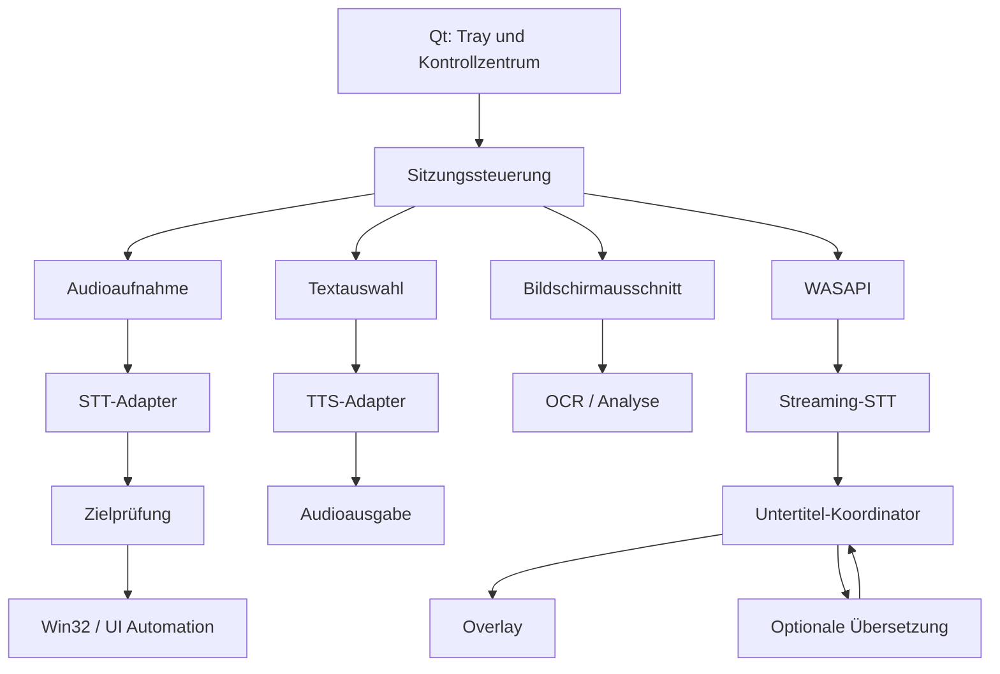

# OMOI VoxBridge

**Sprachschnittstelle für Windows 11** · Python 3.11 · PySide6 · Version 0.1.0

OMOI VoxBridge verbindet Spracheingabe, Vorlesen, Live-Untertitel und KI-gestützte Analyse mit Windows-Anwendungen. Das Projekt demonstriert Systemintegration anhand von Windows-APIs, Audioverarbeitung, lokalen Laufzeiten, Cloud-Schnittstellen und sicherer Prozesssteuerung.

## Funktionen

| Funktion | Implementierung | Stand |
| --- | --- | --- |
| Diktat | OpenAI, Groq, OpenVINO CPU, Faster-Whisper CUDA | Cloud-Anbindung geprüft; native Zielprogramme und GPU separat prüfen |
| Vorlesen | Cartesia, Qwen3-TTS über qualifizierten lokalen Worker | Cloud-Anbindung geprüft; lokale Bereitstellung und Audioabnahme offen |
| Live-Untertitel | WASAPI, OpenAI Realtime, Cartesia Ink Preview | Synthetische Streams geprüft; echte Systemaudio-Abnahme offen |
| Text- und Bildanalyse | OCR, OpenAI, lokale GGUF-Modelle, optional Anthropic | Cloud-Test mit synthetischen Daten; lokale Modelle separat prüfen |
| MCP | Explizite Texteingabe über STDIO | Protokolltests; keine automatische Geräte- oder Bildschirmfreigabe |

Lokale Echtzeitübersetzung ist noch nicht freigegeben. Cartesia Ink Preview ist optional und experimentell. Modellgewichte, Sprachaufnahmen und Zugangsdaten sind nicht enthalten.

## Schnellstart

Voraussetzungen: Windows 11, Python 3.11 (64 Bit), PowerShell. Installation der Python-Abhängigkeiten aus dem Paketindex; kein automatischer Modell-Download.

```powershell
.\scripts\install-dev.ps1 -Plan -IncludeMcp
.\scripts\install-dev.ps1 -IncludeMcp
.\.venv\Scripts\voxbridge-doctor.exe
.\.venv\Scripts\voxbridge-standalone.exe
```

Das Kontrollzentrum öffnet sich per Doppelklick auf das Tray-Symbol. Standard-Diktat: `Ctrl+Alt+Space` startet und beendet die Aufnahme. Modell, Mikrofon, Sprache und Hotkeys sind konfigurierbar. Cloud-Aufrufe benötigen eine ausdrückliche Freigabe. Schlüssel werden ausschließlich zur Laufzeit aus Umgebungsvariablen gelesen.

Für eine Installation außerhalb des Quellordners: [Installation und lokale Laufzeiten](docs/INSTALLATION.md).

## Offline-Demonstration

```powershell
.\.venv\Scripts\python.exe scripts\demo_captions.py
```

Die Vorschau zeigt vorbereitete deutsche und russische Beispielsätze im echten Untertitel-Overlay. Sie benötigt weder ein Mikrofon noch ein Modell, API-Schlüssel oder Netzwerk. Die Texte sind Beispieldaten, keine Live-Transkription.

## Architektur



Die Oberfläche bleibt von Inferenz und Gerätezugriff getrennt. Sitzungs-IDs verwerfen verspätete Ergebnisse. Eigene Prozesse und begrenzte Warteschlangen ermöglichen kontrollierten Abbruch. Ein Providerwechsel löst keine automatische Cloud-Anfrage aus.

## Dokumentation

| Datei | Inhalt |
| --- | --- |
| [Architektur](docs/ARCHITEKTUR.md) | Module, Datenfluss und Windows-Schnittstellen |
| [Installation](docs/INSTALLATION.md) | Wheel, lokale Laufzeiten, API-Konfiguration und Sandbox |
| [Projektvorstellung](docs/PROJEKTVORSTELLUNG.md) | Ablauf einer Kurzpräsentation mit Offline-Demo |
| [Prüfungen](docs/TESTS.md) | Reproduzierbare Tests, Abnahmestand und Grenzen |
| [Lizenzstatus](LICENSE_STATUS.md) | Geplante MIT-Freigabe und offene Lizenzprüfung |
| [Abhängigkeiten](THIRD_PARTY_NOTICES.md) | Lizenzmetadaten externer Bibliotheken |

`src/voxbridge/` enthält die Anwendung, `tests/` die Regressionstests, `scripts/` Installation, Diagnose und Prüfskripte. `SOURCE_MANIFEST.json` dokumentiert den Versionsstand und SHA-256-Prüfsummen.

**Entwicklungsstand:** Die unabhängige Python-Installation und grundlegende Windows-Integration sind geprüft. Physische Audiogeräte, reale Zielanwendungen, autonome lokale Modellbereitstellung und GPU-Abnahme bleiben eigene Prüfschritte. Der Quellcode ist keine freigegebene Endversion.
